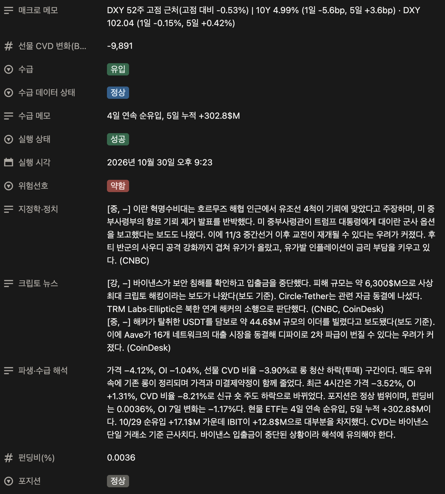
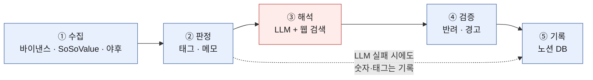
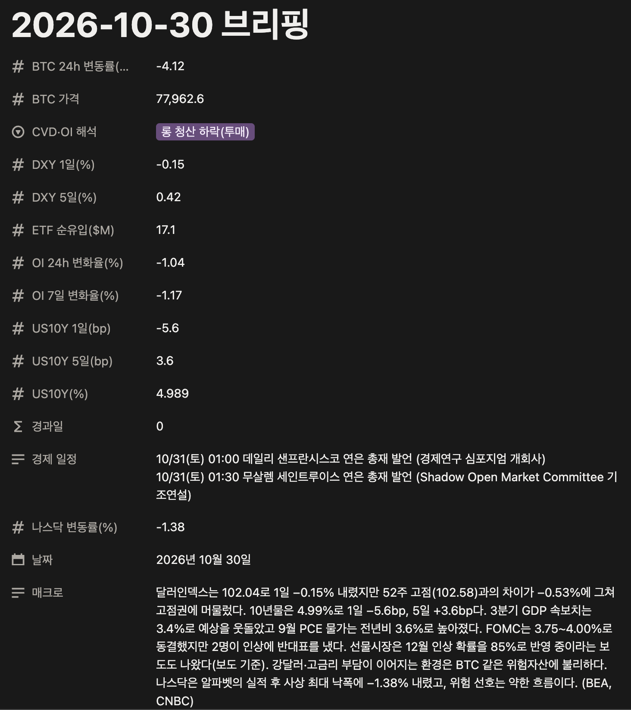

# Market Briefing Agent

비트코인 선물 데스크의 **매일 아침 마켓 브리핑**을 자동으로 만드는 에이전트.
숫자 수집과 분류는 코드가, 뉴스와 해석은 LLM이 맡아서 평일 아침마다 노션 DB에 한 페이지를 쓴다.



*2026-10-30 브리핑 페이지. 수급·포지션·위험선호 태그와 메모는 코드가, 뉴스와 해석 서술은 LLM이 썼다.*

## 배경

트레이딩 데스크에서 매일 11시 회의 전에 바이낸스 파생 지표, 미국 BTC 현물 ETF 수급, 금리·달러·나스닥, 지정학·크립토 뉴스, 경제 일정을 손으로 모아 브리핑했다. 시간이 오래 걸렸고, 같은 숫자를 보고도 사람마다 해석 기준이 달랐다.

재직 중에 이 업무를 자동화하려고 판정 규칙을 설계하고 수집 모듈을 만들었다. 퇴사 후 처음부터 다시 구현해서 LLM 해석, 노션 기록, 자동 실행까지 완성했다.

## 구조



파란색은 코드, 빨간색은 LLM이다. **LLM은 숫자를 만들거나 분류를 정하지 않는다.** 코드가 정한 태그와 숫자를 받아 문장으로 풀어쓰고, 웹 검색으로 뉴스와 일정을 정리한다. 그 출력은 다시 코드가 검증한 뒤에만 노션에 들어간다.

## 핵심 설계 결정

**1. 판정은 코드, 해석은 LLM, 검증은 다시 코드**
"오늘은 롱 청산 하락"이라는 분류를 LLM이 정하면 같은 숫자에도 날마다 결과가 달라질 수 있다. 가격·OI·선물 CVD의 방향 조합으로 코드가 7가지 중 하나로 분류하고([RULES.md](docs/RULES.md)), LLM은 그 분류를 바꾸지 못한다. LLM 출력은 누락·길이·금지 표현(매매 권유, 방향 예측)을 검사해서 위반한 항목은 빈칸으로 둔다.

**2. 데이터를 보고 분류 기준을 정함**
처음에는 현물 CVD와 선물 CVD를 비교해 "현물 주도/선물 주도"로 나누려 했다. 41일치를 보니 현물 CVD 비율의 변동폭이 선물의 약 2배이고 두 시장 모두 평균이 음수여서, 하나의 기준으로 비교할 수 없었다. 그래서 이 분류를 폐기하고 선물 기준 해석으로 단순화했다. 보합 구간(거래량 대비 ±1.5%)은 같은 분포에서 약 1/3이 보합이 되도록 맞췄다.

**3. 데이터 공급자의 지연을 잠정·확정 2단계로 처리**
ETF 데이터(SoSoValue)는 모든 운용사 숫자가 들어와야 합계가 확정되어, 아침 실행 시점에는 전날 합계가 비어 있는 경우가 있다. 합계가 없으면 ETF별 값을 더해 잠정치를 만들고 반영 비율(예: 11/12)을 함께 표시한 뒤, 다음 실행 때 공식 합계로 덮어쓰고 차이를 기록한다.

**4. 최소 권한과 LLM 격리**
- 노션 integration은 페이지 하나에만 연결한다. 노션 API를 호출하는 파일은 하나이고, 함수는 조회·생성·속성 갱신 4개뿐이다. 본문·검색·삭제 API는 코드에 없으며, 테스트가 이를 고정한다.
- LLM은 웹 검색 도구만 쓰고, 빈 임시 폴더에서 실행되며, 환경변수에서 토큰을 지운 상태로 실행된다. 노션에 쓰는 것은 항상 코드다.

자세한 구조는 [docs/ARCHITECTURE.md](docs/ARCHITECTURE.md), 판정 규칙은 [docs/RULES.md](docs/RULES.md).

## 키 없이 돌려보기

API 키나 네트워크 없이, 저장된 실행 기록([examples/2026-10-30.json](examples/2026-10-30.json))으로 판정, 검증, 노션 변환, 안전장치를 확인할 수 있다.

```bash
python3.12 -m venv .venv && .venv/bin/pip install -r requirements.txt   # Python 3.11 이상
.venv/bin/python -m briefing demo
```

```
[1] 코드 판정 재현 (LLM 관여 없음)
  cvd_oi     → 롱 청산 하락(투매)  [일치]
  cvd_oi_4h  → 신규 숏 주도 하락  [일치]
  ...
[2] LLM 출력 검증
  실제 서술: 6/6 통과, 경고 0, 반려 0
  규칙 위반 예시 반려: derivatives ← forbidden phrase: 매수 기회
  규칙 위반 예시 경고: one_liner contradicts tag flow=유입: '순유출'
[3] 노션 속성 31개 생성 (허용 목록 31개 안)
[4] 노션 안전장치
  차단됨: properties not in allowlist: ['임의 속성']
```

## 출력 예시 (2026-10-30)

| 속성 | 값 |
|---|---|
| CVD·OI 해석 | 롱 청산 하락(투매) (최근 4시간은 신규 숏 주도 하락) |
| 수급 메모 | 4일 연속 순유입, 5일 누적 +302.8$M |
| 매크로 메모 | DXY 52주 고점 근처(고점 대비 -0.53%) \| 10Y 4.99% (1일 -5.6bp, 5일 +3.6bp) · DXY 102.04 (1일 -0.15%, 5일 +0.42%) |
| 한줄 판단 | 바이낸스 해킹 충격 속 BTC 4% 급락과 롱 청산, ETF 4일 연속 유입에도 위험 선호는 약한 흐름. |
| 크립토 뉴스 | [강, −] 바이낸스 보안 침해 확인, 입출금 중단 ... |

이날 LLM은 데이터 출처가 바이낸스라는 점을 연결해서, 파생 서술 끝에 "바이낸스 입출금이 중단된 상황이라 해석에 유의해야 한다"고 덧붙였다.

<details>
<summary>같은 페이지의 숫자 속성과 매크로 서술</summary>



</details>

프롬프트를 v1에서 v2로 고친 전후 비교는 [examples/prompt_v1_vs_v2_2026-10-24.json](examples/prompt_v1_vs_v2_2026-10-24.json)에 있다 (한줄 판단 132자 세 문장 → 52자 한 문장, 단위·출처 표기 통일).

## 직접 실행하기

필요한 것: Python 3.11+, [SoSoValue API 키](https://sosovalue.gitbook.io/soso-value-api-doc)(무료), 노션 integration, [Claude Code](https://claude.com/claude-code) CLI 로그인.

```bash
cp .env.example .env                                   # 키와 ID 입력
.venv/bin/python scripts/setup_notion_db.py <노션 페이지 URL>   # DB 1회 생성
.venv/bin/python -m briefing run --dry-run             # 노션에 쓰지 않고 확인
.venv/bin/python -m briefing run                       # 실제 실행
.venv/bin/python -m briefing stats                     # 운영 지표
```

평일 자동 실행 (macOS):

```bash
.venv/bin/python deploy/make_plist.py > ~/Library/LaunchAgents/com.aeagent.briefing.plist
launchctl bootstrap gui/$(id -u) ~/Library/LaunchAgents/com.aeagent.briefing.plist
```

## 운영 지표

`python -m briefing stats`가 쌓인 실행 기록으로 실행 성공률, LLM 검증 통과율, ETF 잠정→확정 오차, 태그 분포를 요약한다.

<!-- TODO: 운영 기간이 쌓이면 stats 결과로 채운다 -->

## 테스트

```bash
.venv/bin/python -m pytest -q
```

네트워크 없이 도는 단위 테스트 97개: 태그 경계값, 휴장·월요일 처리, ETF 연속 일수와 잠정치, 매크로 지표, 노션 안전장치, LLM 출력 검증과 격리, 데모.

## 한계

- CVD와 OI는 바이낸스 단일 거래소 기준 근사치다.
- 보합 구간 같은 임계값은 짧은 기간의 분포로 정했다. 운영 기간이 쌓이면 다시 확인한다.
- 뉴스 선별과 영향 강도 판단은 LLM에 맡긴다. 규칙과 검증으로 범위를 좁혔지만 판단 자체를 보장하지는 않는다.
- 맥이 꺼져 있는 날은 실행되지 않는다.
